# 🐉 Awesome Fantasy Roleplaying Game & World Building 🏰

  

  
  
  
  
  

# 🐉 Top Fantasy Roleplaying & Game World Building ⚔️

**Curated List of SaaS/Commercial Platforms & Open-Source GitHub Projects**  
*Focused on Virtual Tabletops (VTTs), Procedural Fantasy Map Generators, Worldbuilding Wikis, Campaign Managers & Lore Bibles*  
**Last updated: November 2026**

Welcome to the definitive curated index of software, tools, and digital solutions for **Fantasy Roleplaying (TTRPGs)**, **Game World Building**, and **Campaign Lore Architecture**. Whether you are a Game Master orchestrating a multi-year D&D campaign, an indie game developer designing a fictional kingdom, or an author engineering a sprawling fantasy multiverse, this repository provides battle-tested platforms for:

- 🎲 **Virtual Tabletops (VTTs)**: Browser-based and self-hosted engines featuring dynamic line-of-sight lighting, fog of war, animated token combat, dice rollers, and interactive character sheets (`Roll20`, `Foundry VTT`, `Owlbear Rodeo`, `PlanarAlly`).
- 🗺️ **Procedural & Vector Cartography**: Continent, dungeon, city, and battlemap makers with SVG/PNG/GeoJSON export support (`Azgaar's Fantasy Map Generator`, `Watabou Medieval Fantasy City Generator`, `Inkarnate`, `Tiled`).
- 📚 **Worldbuilding Lore Bibles & Campaign Wikis**: Interlinked Markdown vaults, entity relationship networks, interactive timeline charts, and GM campaign dashboards (`World Anvil`, `Talorys`, `LegendKeeper`, `Campfire`, `Chronicler`, `Fantasia Archive`, `Kanka`).
- 🧙 **Ruleset Compendiums & SRD Automation**: Deep character builders and SRD ruleset implementations for D&D 5e/2024, Pathfinder, and indie systems.

---

### 🌟 Key Highlights & Market Trends
- **🚀 Commercial Category Leaders**: D&D Beyond (Hasbro / Wizards of the Coast), Roll20, Foundry VTT, Fantasy Grounds (SmiteWorks), Inkarnate, World Anvil, Alchemy RPG, Campfire Technology, Owlbear Rodeo, and LegendKeeper.
- **🛡️ Open-Source & Self-Hosted Powerhouses**: Extensive coverage of self-hosted VTTs (`PlanarAlly`, `MapTool`, `Atlas VTT`), procedural map tools (`Azgaar's FMG`, `Watabou Procgen`, `Tiled`), and offline-first lore wikis (`Talorys`, `Fantasia Archive`, `Chronicler`, `Kanka`) for creators seeking data ownership and $0 recurring subscriptions.

🤝 **Contributions welcome!** Check out the [Contribution Guidelines](#-how-to-contribute) to add or update projects. Please ensure descriptions are accurate, neutral, and accompanied by transparent tier and pricing information.

---

## 📑 Table of Contents

- [📊 Sector Overview & Market Dynamics](#-sector-overview--market-dynamics)
- [☁️ SaaS/Hosted & Commercial Platforms](#️-saashosted--commercial-platforms)
- [💻 Open-Source GitHub Projects](#-open-source-github-projects)
- [📈 Star History](#-star-history)
- [🛠️ How to Contribute](#️-how-to-contribute)
- [⚠️ Disclaimer](#️-disclaimer)
- [💖 Support & Thank You](#-support--thank-you)

## 📊 Sector Overview & Market Dynamics

The global Tabletop RPG (TTRPG), Virtual Tabletop (VTT) & Digital Worldbuilding Software market is valued at approximately **$2.4B–$3.1B+ in 2026**, expanding at a ~14%–18% CAGR fueled by online VTT campaigns, indie RPG systems, and AI-assisted narrative/cartography tools. The official rulebook and VTT distribution layer exhibits **strong winner-take-most consolidation** around D&D Beyond (Hasbro/WotC), Roll20, and Foundry VTT, while the cartography, lore-wiki, and system-agnostic VTT layers remain **vibrantly fragmented and deeply supported by open-source tools** (`Azgaar's FMG`, `MapTool`, `PlanarAlly`, `Talorys`, `Tiled`).

## ☁️ SaaS/Hosted & Commercial Platforms

*Sorted descending by company valuation / annual revenue scale.*

| Platform | Description | Company Scale (Valuation / Revenue) | Starting Paid Tier | Free Tier / Trial Limit |

| :--- | :--- | :--- | :--- | :--- |

| **[D&D Beyond (Hasbro / Wizards of the Coast)](https://dndbeyond.com)** | Official digital toolset, interactive character builder, encounter tracker, and Maps VTT for Dungeons & Dragons 5e/2024 rules. | **Part of Hasbro / WotC** (~$146M acquisition price; ~$1.4B+ WotC annual revenue) | **$2.99 / month** ($25.99/yr Hero tier) or **$5.99 / month** ($54.99/yr Master tier) | **Forever Free Basic Account** (Up to **6 active characters**, Basic Rules SRD content, and basic encounter builder) |

| **[Roll20](https://roll20.net)** | Browser-based Virtual Tabletop, digital marketplace, and character-sheet platform supporting hundreds of TTRPG systems and integrated voice/video. | **~$50M–$100M Est. Valuation** (~$20M–$35M est. ARR; merged with OneBookShelf/DriveThruRPG) | **$5.99 / month** ($49.99/yr Plus) or **$10.99 / month** ($99.99/yr Pro with dynamic lighting) | **Forever Free Account** (Unlimited campaigns/players, **100 MB asset storage**, and standard grid/dice tools with in-app ads) |

| **[Foundry VTT](https://foundryvtt.com)** | Modern, self-hosted or partner-cloud JavaScript Virtual Tabletop featuring dynamic lighting, walls, audio playlists, and 300+ community game systems. | **~$15M–$30M Est. Scale** (Profitable independent flagship VTT software studio) | **$50.00 one-time license** (Perpetual license for GM; players connect free; optional cloud hosting ~$4–$10/mo via The Forge/Molten) | **Interactive Live Web Demo** (Full browser-based player/GM demo sandbox on foundryvtt.com; no perpetual free self-hosted binary) |

| **[Fantasy Grounds (SmiteWorks)](https://fantasygrounds.com)** | Feature-rich desktop and cloud-brokered Virtual Tabletop with deep ruleset automation for D&D, Pathfinder, Savage Worlds, and Call of Cthulhu. | **~$10M–$20M Est. Scale** (Established independent VTT software company) | **$4.99 / month** (Standard) or **$9.99 / month** (Ultimate, or **$50 one-time** perpetual license) | **Forever Free Demo / Player Client** (Players connect 100% free to Ultimate-licensed GMs; unlimited offline/demo campaign building) |

| **[Inkarnate](https://inkarnate.com)** | Browser-based fantasy map-making studio enabling worldbuilders to paint parchment world maps, regional kingdoms, isometric cities, and battlemaps. | **~$10M–$20M Est. Valuation** (~$3M–$6M est. ARR; bootstrapped) | **$5.00 / month** (or **$25.00 / year** billed annually for Inkarnate Pro) | **Forever Free Basic Plan** (Up to **10 maps**, 100 MB storage, 500+ free art stamps, and standard 1024px non-commercial exports) |

| **[World Anvil](https://worldanvil.com)** | Comprehensive worldbuilding wiki, interactive map-pinning suite, timeline generator, and campaign manager for authors and Game Masters. | **~$5M–$15M Est. Valuation** (~$2M–$5M est. ARR; >2M worldbuilders) | **$4.50 / month** billed annually ($54/yr Journeyman) or **$7.50 / mo** Master | **Forever Free Freeman Plan** (Unlimited public articles, **2 worlds**, 100 MB storage, and basic character/timeline templates) |

| **[Alchemy RPG](https://alchemyrpg.com)** | Immersive, theater-of-the-mind Virtual Tabletop combining animated motion scenes, ambient soundscapes, tactical maps, and built-in video chat. | **~$10M–$15M Est. Valuation** (~$2.5M+ Kickstarter & seed funding) | **$8.00 / month** billed annually ($96/yr Alchemy Unlimited) | **Forever Free Starter Plan** (Up to **3 custom games**, 3 custom characters, 1 GB asset storage, and unlimited joining of friends' games) |

| **[Campfire Technology](https://campfirewriting.com)** | Modular worldbuilding and novel/campaign bible software with interconnected character, magic-system, species, language, and map modules. | **~$5M–$10M Est. Scale** (Profitable independent creative writing & worldbuilding studio) | **~$0.50 – $2.00 / module / month** modular pricing (or **$12.50/mo** all-access bundle; one-time lifetime options) | **Forever Free Starter Tier** (Up to **10 characters, 5 locations, 5 encyclopedia articles, 1 map**, and 25,000 manuscript words free forever) |

| **[Owlbear Rodeo](https://owlbear.rodeo)** | Lightweight, fast, zero-bloat browser Virtual Tabletop focused on instant battlemap sharing, fog of war, tokens, and extensions. | **~$2M–$5M Est. Scale** (Bootstrapped Australian indie VTT studio) | **$3.99 / month** ($39.99/yr Fledgling) or **$7.99 / month** ($79.99/yr Nestling) | **Forever Free Hatchling Plan** (Up to **2 active rooms**, **200 MB cloud storage**, dynamic fog of war, and unlimited players) |

| **[LegendKeeper](https://legendkeeper.com)** | Fast, multiplayer-first worldbuilding wiki, nested map atlas, and visual whiteboard designed for Game Masters and narrative designers. | **~$2M–$5M Est. Scale** (Independent creator-led SaaS) | **$9.00 / month** (or **$90.00 / year** billed annually; players join GM worlds free) | **14-Day Full-Access Free Trial** (Unlimited wiki pages, nested atlas maps, and multiplayer boards during 14-day evaluation; no perpetual free tier) |

## 💻 Open-Source GitHub Projects

*Sorted descending by GitHub stars count.*

| Project | Description | License / Hosting Model | Free Tier / Self-Hosted Limit |
| :--- | :--- | :--- | :--- |
| **[Tiled Map Editor (`mapeditor/tiled`)](https://github.com/mapeditor/tiled)**  | Flexible, general-purpose 2D tile map editor and world compositor widely used for fantasy battlemaps, dungeon layouts, and RPG tilemaps. | **GPL-2.0 / Open-Source** ($0 self-hosted desktop app) | **100% Free Forever** (Native cross-platform desktop build on Windows, macOS, Linux with full export support) |
| **[Azgaar's Fantasy Map Generator (`Azgaar/Fantasy-Map-Generator`)](https://github.com/Azgaar/Fantasy-Map-Generator)**  | Procedural vector fantasy map generator rendering realistic continents, relief, biomes, political borders, provinces, rivers, and military forces. | **MIT License / Open-Source** ($0 web app or self-hosted) | **100% Free Forever** (Unlimited procedurally generated worlds, SVG/PNG/GeoJSON/heightmap exports, zero paywalls) |
| **[Medieval Fantasy City Generator (`watabou/TownGeneratorOS`)](https://github.com/watabou/TownGeneratorOS)**  | Watabou's iconic procedural generator for medieval fantasy towns, castles, and cities with customizable density, districts, and rivers. | **MIT License / Open-Source** ($0 browser/desktop) | **100% Free Forever** (Unlimited procedural town generation with SVG and PNG exports, completely free offline and online) |
| **[Talorys (`rociiu/talorys`)](https://github.com/rociiu/talorys)**  | Open-source fantasy roleplaying and worldbuilding companion designed to organize intricate lore, characters, locations, and campaign narratives. | **GPL-3.0 / Open-Source** ($0 self-hosted local tool) | **100% Free Forever** (Unlimited fantasy worlds, lore entries, character sheets, and campaign management locally/self-hosted) |
| **[MapTool (`RPTools/maptool`)](https://github.com/RPTools/maptool)**  | Battle-tested, highly customizable Java Virtual Tabletop (VTT) supporting dynamic lighting, vision blocking, complex macros, and any RPG system. | **GPL-3.0 / Open-Source** ($0 self-hosted peer-to-peer) | **100% Free Forever** (Unlimited players, campaigns, maps, and automated token scripting with direct P2P connections) |
| **[Chronicler (`mak-kirkland/chronicler`)](https://github.com/mak-kirkland/chronicler)**  | Offline worldbuilding tool and local wiki for writers, Game Masters, and TTRPG creators storing notes as pure Markdown files on your device. | **GPL-3.0 / Open-Source** ($0 local offline application) | **100% Free Forever** (No cloud, no accounts, unlimited notes, Markdown vaults, and relationships saved locally) |
| **[Atlas VTT (`atlas-vtt/atlas-vtt`)](https://github.com/atlas-vtt/atlas-vtt)**  | Open-source Virtual Tabletop integrated into Obsidian with battle maps, tokens, fog of war, dice rollers, initiative, and player second-screen view. | **MIT License / Open-Source** ($0 Obsidian plugin) | **100% Free Forever** (Unlimited local battlemaps, fog of war, dual-screen display, and zero monthly subscriptions) |
| **[Foundry VTT 5e System (`foundryvtt/dnd5e`)](https://github.com/foundryvtt/dnd5e)**  | The open-source community SRD game system implementation powering Dungeons & Dragons Fifth Edition inside Foundry Virtual Tabletop. | **MIT License / Open-Source** ($0 community package) | **100% Free Forever** (Includes full SRD 5.1/5.2 compendiums, rules automation, actor sheets, and item tracking) |
| **[PlanarAlly (`Kruptein/PlanarAlly`)](https://github.com/Kruptein/PlanarAlly)**  | Open-source, web-based Virtual Tabletop with a deep focus on dynamic line-of-sight lighting, stealth/vision mechanics, and self-hosting. | **MIT License / Open-Source** ($0 self-hosted server) | **100% Free Forever** (Unlimited self-hosted rooms, dynamic lighting layers, custom shapes, and full data sovereignty) |
| **[Notebook.ai (`indentlabs/notebook`)](https://github.com/indentlabs/notebook)**  | Open-source universe creation notebook and worldbuilding tracker for authors, game designers, and roleplayers to manage interconnected lore. | **MIT License / Open-Source** ($0 self-hosted Rails app) | **100% Free Forever** (Self-hosted installation supports unlimited universes, characters, locations, items, and magic systems) |
| **[Fantasia Archive (`vishiri/fantasia-archive`)](https://github.com/vishiri/fantasia-archive)**  | Free, completely offline, local-first worldbuilding database and encyclopedia software for novelists, RPG GMs, and world creators. | **GPL-3.0 / Open-Source** ($0 local offline application) | **100% Free Forever** (Unlimited entries, rich entity relationships, and document hierarchies stored 100% on your local machine) |
| **[Kanka (`owlchester/kanka`)](https://github.com/owlchester/kanka)**  | Community-driven worldbuilding and tabletop RPG campaign management suite featuring interactive maps, timelines, and entity relations. | **AGPL-3.0 / Open-Source** ($0 self-hosted Laravel app) | **100% Free Forever** (Self-hosted core allows unlimited entities, campaigns, timeline events, and community modules) |

---

## 📈 Star History

---

## 🛠️ How to Contribute

Contributions are warmly welcomed! Help keep this repository the most complete, accurate, and up-to-date resource for Game Masters, worldbuilders, and RPG developers:

1. 🍴 **Fork the repository** to your GitHub account.
2. 🌿 **Create a branch** for your addition (`git checkout -b feature/add-new-ttrpg-tool`).
3. 📝 **Add your entry** adhering to the existing markdown table format:
   - For SaaS tools: include verified starting tier pricing, explicit free tier / trial limits, and company scale estimates.
   - For Open-Source tools: include a social-style star badge linked to the repo's stargazers page and ensure entries remain sorted descending by star count.
4. 🧪 **Check formatting** to ensure links, badges, and tables render cleanly.
5. 🚀 **Submit a Pull Request** with a concise description of the added tool.

---

## ⚠️ Disclaimer

Product names, logos, trademarks, and registered trademarks cited in this repository are property of their respective owners. Mention of commercial software (e.g., Wizards of the Coast / D&D Beyond, Roll20, Foundry VTT) does not imply endorsement, affiliation, or sponsorship. Pricing tiers and trial allowances are based on publicly available documentation as of late 2026 and are subject to change by vendors.

---

## 💖 Support & Thank You

A huge thank you to all the dungeon masters, worldbuilders, authors, cartographers, and open-source contributors who pour their imagination into expanding tabletop and digital roleplaying! 🎲✨

If you find this curated directory helpful for your campaigns or game dev projects:
- ⭐ **Star this repository** to help fellow worldbuilders discover it!
- 🍴 **Fork and share** it with your TTRPG group, gaming guild, or indie community.
- ☕ **Buy me a coffee / Sponsor**: If you'd like to support ongoing curation and maintenance, visit the **[GitHub Sponsors Dashboard](https://github.com/sponsors/ishandutta2007)**! Every bit of support is deeply appreciated! 💖

